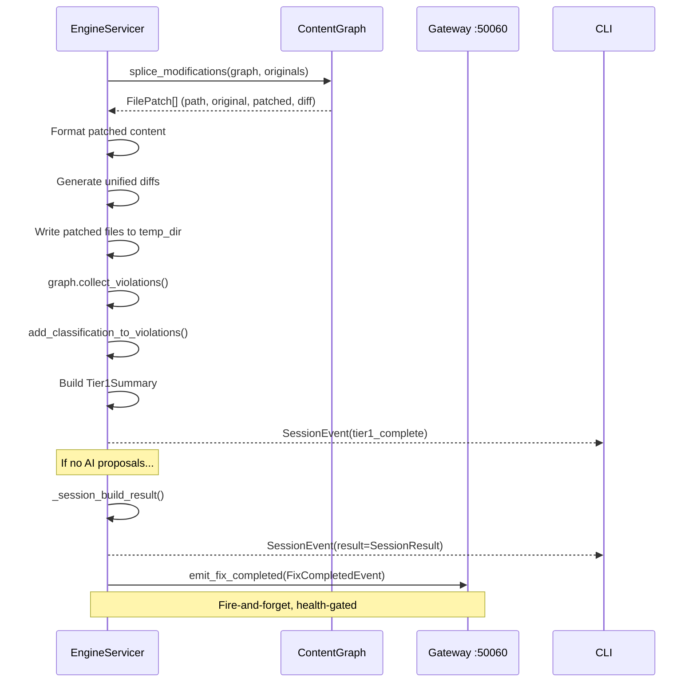

# 11 — Result Assembly and Reporting

> Previous: [10 — Human Approval Flow](10-human-approval.md) | Next: [12 — CLI Output and Presentation](12-output-and-presentation.md)

## Purpose

After convergence and approval, the Engine assembles the final
`SessionResult` containing file patches, remaining violations, the fix
report, and aggregate scan diagnostics (issue #512). It also emits a
`FixCompletedEvent` to the Gateway for persistence, carrying the same
diagnostics.

## Sequence



## splice_modifications()

`src/apme_engine/remediation/graph_engine.py` — this function bridges the
in-memory `ContentGraph` back to file content:

1. **Identify modified nodes** — nodes with at least two progression entries
   where the original hash differs from the effective (approved) hash.
   Bounded progression history retains both the original baseline and the most
   recent approved snapshot even when later pending attempts fill the buffer.

2. **Group changed spans by file** — compare each node's effective YAML
   with its original progression state and collect only changed line spans.
   This preserves independently modified children when a parent block or
   play header is also edited. Header fragments replace only the source
   lines they actually contain, rather than the full play span.

   Snippet trailing newlines are normalized before comparison. Equal-length
   replacements split into atomic source-line changes: agreed changes apply
   once and independent adjacent changes compose. Separately proposed boundary
   insertions from the same or nested source owner can identify a shared prefix
   or suffix, which also applies once. Touching boundaries owned by separate
   sibling tasks remain independent and apply in source-owner order, including
   identical text. At a shared closing boundary, child additions precede their
   enclosing block's additions; following siblings begin afterward.
   Other length-changing overlaps are rejected when no line correspondence is
   established. Source text is never aligned across words, comments, or task
   names. Conflicting line replacements and competing insertions raise an
   error. Whenever multiple nodes contribute to a file, combined edits are
   parsed with the formatter's round-trip YAML 1.1 loader before persistence.
   Duplicate keys are rejected after scalar resolution, including disjoint
   changes that produce equivalent numeric or boolean keys.

   All owners contributing to a combined patch retain per-line YAML structural
   roles from each proposed snapshot. After assembly, mapping fields, sequence
   items, and comments must retain their container-kind roles; a field cannot
   silently become text inside a block-scalar script merely because the YAML
   still parses. Each snapshot is parsed once through YAML events, which retain
   alias occurrences without resolving external anchors. Final assembled YAML
   still undergoes full alias validation. Unchanged intervening lines do not
   exempt nested or sibling edits from these checks. A single owner's patch
   avoids this additional snapshot parsing.

   Conflicts raise `SpliceConflictError`. Initial remediation, approval, and AI
   gates report this as a `remediation_failed` session event with the conflict
   message; it is not an invalid client argument or a gRPC stream abort. Working
   file restoration and patch writes happen only after successful assembly.
   Approval decisions are previewed on a graph copy. A conflict leaves the
   graph, pending proposals, approval telemetry, and working bytes unchanged,
   so the client can retry with different approval choices.
   Pure preview and blocking disk persistence run in an executor. Prepared
   patches include Gate 2 snapshot restorations and baseline bytes for affected
   files whose edits were rejected, so changed choices overwrite earlier partial
   writes. Restoration payloads stay as raw bytes alongside text splice patches;
   untouched templates and other non-UTF-8 files are never decoded. Persist the
   entire batch before committing decisions on the event-loop thread, verifying the captured
   proposal set before persistence and again at commit. A failed write emits
   `remediation_failed` and leaves live proposals, graph, telemetry, and working
   bytes unchanged; a retry writes the full batch, including any files already
   written before the failure. A session guard rejects overlapping mutations
   and remains held until canceled workers finish.
   Once persistence starts, an owned continuation completes persistence, commit,
   and the next gate even if the stream disconnects; replay waits for that
   durable state and duplicate approvals replay it without advancing the phase
   again. Sealed, resumable sessions survive disconnect cleanup while incomplete uploads and
   interrupted initial processing are removed. Reporting runs after durable
   events are ready and the approval guard is released, without delaying result
   delivery or the subsequent close handshake. The approval handler returns
   after delivering its events while the session retains the reporting task
   until completion, including after close or disconnect.

   All gates use the same post-splice formatter with full source paths and the
   session file inventory, preserving role-source context consistently.

3. **Bottom-up splice** — sort edits by `line_start` descending so that
   splicing one edit does not shift line numbers for edits above it. Replace
   `lines[line_start-1:line_end]` with the new YAML text.

4. **Generate diffs** — `difflib.unified_diff()` between original and patched
   content.

5. **Return `FilePatch`** — path, original text, patched text, diff, and
   rule IDs.

The `include_pending` parameter controls whether to use the latest
progression entry (for convergence rescans) or only approved entries (for
final output).

## Post-Splice Formatting

Each patched file is run through `format_content()` again to ensure the
spliced YAML conforms to formatting conventions. The formatted result
replaces the patched content before diff generation.

## SessionResult

`_session_build_result()` constructs the final `SessionResult` proto:

```protobuf
message SessionResult {
  repeated FilePatch patches = 1;
  FixReport report = 2;
  repeated Violation remaining_violations = 3;
  repeated Violation fixed_violations = 4;
}
```

- **patches** — per-file diffs (original bytes, patched bytes, unified diff)
- **report** — `FixReport` with pass count, fixed count, remaining AI/manual
  counts, oscillation flag
- **remaining_violations** — violations that persist after remediation
- **fixed_violations** — violations resolved by transforms

## FixReport

```protobuf
message FixReport {
  int32 passes = 1;
  int32 fixed = 2;
  int32 remaining_ai = 3;
  int32 remaining_manual = 4;
  bool oscillation_detected = 5;
  repeated Violation remaining_violations = 6;
  repeated Violation fixed_violations = 7;
}
```

The report is built from the `GraphFixReport` returned by the convergence
loop, enriched with remediation class counts from `partition.py`.

## Event Emission

After sending the `SessionResult` to the client, the Engine emits a
`FixCompletedEvent` to the Gateway for persistence:

```python
await emit_fix_completed(self._build_fix_event(session, ...))
```

### FixCompletedEvent

`proto/apme/v1/reporting.proto` — carries everything the Gateway needs to
persist the scan:

| Field | Content |
|-------|---------|
| `scan_id` | Correlation identifier |
| `session_id` | Session hash |
| `project_path` | Project root path |
| `source` | "cli" |
| `remaining_violations` | Proto violations |
| `fixed_violations` | Proto violations |
| `summary` | ScanSummary (total, auto_fixable, ai_candidate, manual_review) |
| `report` | FixReport |
| `proposals` | ProposalOutcome[] (approved/rejected) |
| `logs` | ProgressUpdate[] (pipeline logs) |
| `patches` | FilePatch[] (per-file diffs) |
| `manifest` | ProjectManifest (collections, packages, dependency tree) |
| `content_graph_json` | Serialized ContentGraph |

### Fire-and-Forget Design

Event emission is **best-effort and health-gated** (ADR-020):

- Uses `GrpcReportingSink` with periodic health probes
- When the Gateway is unavailable, events are dropped (not queued)
- Failure never blocks the scan/fix path
- Short fast-fail timeout (1s) when endpoint is known-down

This ensures the engine scan path is never bottlenecked by persistence.

## ProjectManifest

`_build_manifest()` constructs the manifest from session state:

- `ansible_core_version` — from the session venv
- `collections[]` — `CollectionRef` protos with FQCN, version, source
  (specified/learned/dependency), license, supplier
- `python_packages[]` — `PythonPackageRef` protos with name, version,
  license, supplier
- `requirements_files` — paths to discovered requirements files
- `dependency_tree` — raw `uv pip tree` output

### License resolution

Packages and collections publish license data in inconsistent ways, so
`src/apme_engine/licensing.py` centralises the rules instead of reading a
single metadata field:

- Python packages: PEP 639 `License-Expression` -> an SPDX-shaped `License`
  value -> a recognised free-text name (`ISC License`) -> a recognised license
  body -> Trove `License ::` classifiers. `ansible-core` publishes none of the
  first four fields and is resolved from its GPLv3+ classifier. A short value
  carrying a restrictive marker (`Commercial Apache License version 2.0`) is
  kept verbatim instead of being mapped to the license name it resembles, and
  a classifier without an unambiguous SPDX id (`BSD License`,
  `Other/Proprietary License`) is reported by its human-readable name rather
  than dropped.
- Collections: a non-empty `MANIFEST.json`/`galaxy.yml` `license` list is
  authoritative. A list of SPDX identifiers is joined with `OR` (a choice),
  while a list that is not fully SPDX is joined with `AND`: a consumer is bound
  by every declared value, and a comma-joined `MIT, SSPL-1.0, Custom terms`
  would let the `MIT` hint make the whole list look open source. Only when the
  list is empty does the resolver fall back to an SPDX-named `license_file`,
  then to SPDX-named files in `LICENSES/` (REUSE layout, used by `community.general`,
  `amazon.aws`, `ansible.posix`, ... which all declare `license: []`), then to
  the body of `license_file`. `LICENSES/` entries name the licenses used by
  files in the collection, not alternatives a consumer may choose between, so
  they are joined with `AND`. Collection metadata is untrusted: only regular
  files whose resolved path stays inside the collection directory are read,
  with a bounded prefix per file. An SPDX-named `license_file` is only trusted
  once that file is verified inside the collection — a `license_file: MIT.txt`
  that is not there must not mask a `LICENSES/SSPL-1.0.txt` sibling. A
  `LICENSES/` listing larger than the scan limit is not summarized at all — a
  truncated list could omit the only restricted license and leave an
  open-source sibling looking like the whole collection — so the value stays
  `unknown` and asks for review, and the directory is enumerated incrementally
  so a huge listing cannot be materialised just to be rejected. Only lone
  identifiers are accepted from file names: an expression-shaped
  `MIT OR ISC.txt` does not establish how its alternatives relate, and joining
  it into `MIT OR ISC AND SSPL-1.0` would let operator precedence pick the
  permissive branch, so it marks the listing unverified as well. So does an
  entry that names no license at all: `MIT.txt` beside `Commercial
  License.txt` yields an unverified listing rather than a lone `MIT`, because
  skipping the unrecognised entry would drop a restricted sibling.
- A value naming several licenses reaches classification whole. Name and body
  detection match a substring (`apache license ... version 2.0`), so resolving
  `Apache License version 2.0 AND SSPL-1.0` would store `Apache-2.0` and drop
  the restricted operand before it is evaluated. Operand splitting is confined
  to short values, or to operator-joined lists whose operands are all short, so
  a license body ("TERMS AND CONDITIONS") is never read as a list.
- The same restriction scan applies to a package `License` field that carries a
  full body: the body is longer than the short-name marker limit, so only the
  supplemental scan over a recognized body keeps `MIT with Commons Clause`.
- A license file larger than the read window is unverified rather than
  detected from its first 64 KiB: one extra byte is read to tell a complete
  file from a truncated prefix, because a restriction can sit past the window.
- A bare file name is display text, not a declaration: an absent or unreadable
  `license_file` keeps its name (`MIT.txt`) but stays `unknown`, because the
  `mit` hint would otherwise report an unverified file as open source. SPDX
  identity is decided before that check, so a declared custom reference
  (`LicenseRef-Acme.EULA`) is still flagged rather than read as a file name.
- License bodies are matched on their title near the start of the file, after a
  scan for restrictions that are *added to* a base license (`Commons Clause`):
  such a notice is kept as `MIT with Commons Clause` instead of being reduced to
  the `MIT` grant below it. The generic proprietary markers are deliberately
  not applied to bodies — BSD boilerplate says "All rights reserved" and GPL
  text mentions "commercial". A full GPLv3 `COPYING` names the Affero GPL in
  section 13 and its "How to Apply"
  appendix contains "any later version", so a body-wide search mislabels it
  `AGPL-3.0-or-later`; a bare license body therefore yields the `-only`
  variant, and `-or-later` has to come from metadata.

The same module classifies each value as `open-source`, `proprietary`, or
`unknown`; the REST API exposes that as `license_status` so the UI can flag
non-open-source dependencies in red for legal review. Only positive evidence
of a non-open-source license counts as `proprietary`, and restrictive markers
are checked before license-name matching so an explicit restriction is never
overwritten by a permissive signature. SPDX expressions are evaluated as a
parse tree with `AND` binding tighter than `OR`: an `OR` is `open-source` as
soon as one alternative is, an `AND` is `proprietary` as soon as one required
component is and `open-source` only when every component is known open source,
and a `WITH` exception keeps its base license's verdict. An unclassified
component leaves the verdict `unknown` (neutral) rather than guessing, and
open-source hints match whole words so `mit` cannot match inside "Limited".
A restriction that is not an SPDX license of its own (`MIT with Commons
Clause`) is recognised through the marker list rather than the leading
open-source name, and a short value mixing licenses without being valid SPDX
(`MIT and FooBar-9.9`) is decided operand by operand — one matching
open-source name never decides the whole value, a restricted operand makes the
whole value `proprietary`, and each operand's SPDX identity is resolved before
free-text hints so `LicenseRef-MIT` is not read as `MIT`. Only short values are
split; a license body is recognised by its title instead, and a recognised
license *name* is checked before the split so `GNU General Public License v3
or later (GPLv3+)` is not read as a compound. Classification canonicalizes
expressions up to a larger bound than storage does, so padding a value past
the storage limit cannot degrade it into a hint match and hide a restricted
component; the authoritative PEP 639 `License-Expression` field uses that same
bound when it is stored, while `License` free text keeps the smaller storage
bound so a license body is not mistaken for an identifier — except that a
`License` value which is not body-shaped still gets the bounded expression
parse, so a long declared expression is not dropped in favour of a permissive
classifier. Deprecated `X+` identifiers are normalized to `X-or-later` during
canonicalization, because `packaging` keeps the deprecated spelling, which is
neither in the open-source identifier set nor a valid CycloneDX `license.id`.

## Key Source Files

| File | Key types/functions |
|------|---------------------|
| `src/apme_engine/remediation/graph_engine.py` | `splice_modifications()`, `FilePatch`, `GraphFixReport` |
| `src/apme_engine/daemon/engine_server.py` | `_session_build_result()`, `_build_fix_event()`, `_build_manifest()` |
| `src/apme_engine/daemon/event_emitter.py` | `emit_fix_completed()`, `EventSink` protocol |
| `src/apme_engine/daemon/sinks/grpc_reporting.py` | `GrpcReportingSink` |
| `proto/apme/v1/reporting.proto` | `FixCompletedEvent`, `ReportAck` |
| `proto/apme/v1/engine.proto` | `SessionResult`, `FixReport`, `FilePatch` |

## Related ADRs

- **ADR-020** — Event sink abstraction (engine emits, never queries out)
- **ADR-029** — Stateless engine, persistence at the edge
- **ADR-040** — Dependency manifest (ProjectManifest)

---

> Next: [12 — CLI Output and Presentation](12-output-and-presentation.md)
