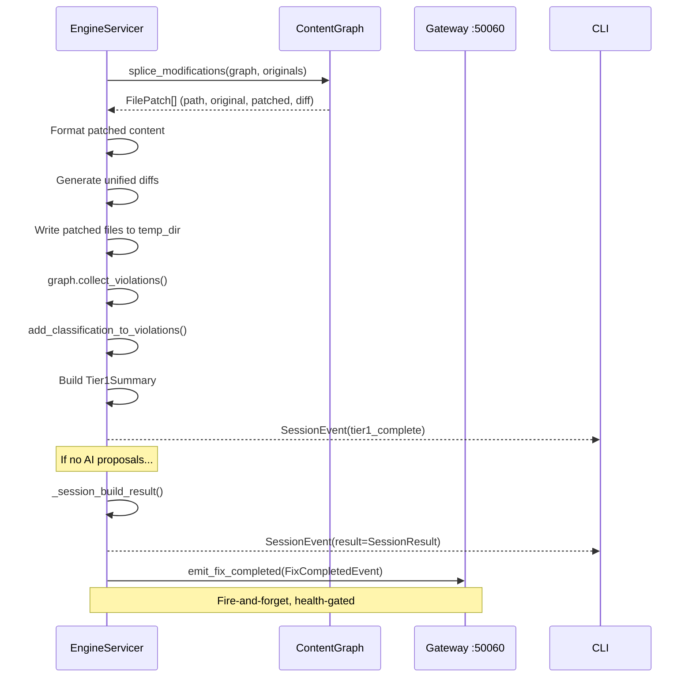

# 11 — Result Assembly and Reporting

> Previous: [10 — Human Approval Flow](10-human-approval.md) | Next: [12 — CLI Output and Presentation](12-output-and-presentation.md)

## Purpose

After convergence and approval, the Engine assembles the final
`SessionResult` containing file patches, remaining violations, and the fix
report. It also emits a `FixCompletedEvent` to the Gateway for persistence.

## Sequence



## splice_modifications()

`src/apme_engine/remediation/graph_engine.py` — this function bridges the
in-memory `ContentGraph` back to file content:

1. **Identify modified nodes** — nodes with at least two progression entries
   where the original hash differs from the effective (approved) hash.
   Bounded progression history retains both the original baseline and the most
   recent approved snapshot even when later pending attempts fill the buffer.

2. **Group changed spans by file** — compare each node's effective YAML
   with its original progression state and collect only changed line spans.
   This preserves independently modified children when a parent block or
   play header is also edited. Header fragments replace only the source
   lines they actually contain, rather than the full play span.

   Snippet trailing newlines are normalized before comparison. Equal-length
   replacements split into atomic source-line changes: agreed changes apply
   once and independent adjacent changes compose. Separately proposed boundary
   insertions from the same or nested source owner can identify a shared prefix
   or suffix, which also applies once. Touching boundaries owned by separate
   sibling tasks remain independent and apply in source-owner order, including
   identical text. At a shared closing boundary, child additions precede their
   enclosing block's additions; following siblings begin afterward.
   Other length-changing overlaps are rejected when no line correspondence is
   established. Source text is never aligned across words, comments, or task
   names. Conflicting line replacements and competing insertions raise an
   error. Whenever multiple nodes contribute to a file, combined edits are
   parsed with the formatter's round-trip YAML 1.1 loader before persistence.
   Duplicate keys are rejected after scalar resolution, including disjoint
   changes that produce equivalent numeric or boolean keys.

   All owners contributing to a combined patch retain per-line YAML structural
   roles from each proposed snapshot. After assembly, mapping fields, sequence
   items, and comments must retain their container-kind roles; a field cannot
   silently become text inside a block-scalar script merely because the YAML
   still parses. Each snapshot is parsed once through YAML events, which retain
   alias occurrences without resolving external anchors. Final assembled YAML
   still undergoes full alias validation. Unchanged intervening lines do not
   exempt nested or sibling edits from these checks. A single owner's patch
   avoids this additional snapshot parsing.

   Conflicts raise `SpliceConflictError`. Initial remediation, approval, and AI
   gates report this as a `remediation_failed` session event with the conflict
   message; it is not an invalid client argument or a gRPC stream abort. Working
   file restoration and patch writes happen only after successful assembly.
   Approval decisions are previewed on a graph copy. A conflict leaves the
   graph, pending proposals, approval telemetry, and working bytes unchanged,
   so the client can retry with different approval choices.
   Pure preview and blocking disk persistence run in an executor. Prepared
   patches include Gate 2 snapshot restorations and baseline bytes for affected
   files whose edits were rejected, so changed choices overwrite earlier partial
   writes. Restoration payloads stay as raw bytes alongside text splice patches;
   untouched templates and other non-UTF-8 files are never decoded. Persist the
   entire batch before committing decisions on the event-loop thread, verifying the captured
   proposal set before persistence and again at commit. A failed write emits
   `remediation_failed` and leaves live proposals, graph, telemetry, and working
   bytes unchanged; a retry writes the full batch, including any files already
   written before the failure. A session guard rejects overlapping mutations
   and remains held until canceled workers finish.
   Once persistence starts, an owned continuation completes persistence, commit,
   and the next gate even if the stream disconnects; replay waits for that
   durable state and duplicate approvals replay it without advancing the phase
   again. Sealed, resumable sessions survive disconnect cleanup while incomplete uploads and
   interrupted initial processing are removed. Reporting runs after durable
   events are ready and the approval guard is released, without delaying result
   delivery or the subsequent close handshake. The approval handler returns
   after delivering its events while the session retains the reporting task
   until completion, including after close or disconnect.

   All gates use the same post-splice formatter with full source paths and the
   session file inventory, preserving role-source context consistently.

3. **Bottom-up splice** — sort edits by `line_start` descending so that
   splicing one edit does not shift line numbers for edits above it. Replace
   `lines[line_start-1:line_end]` with the new YAML text.

4. **Generate diffs** — `difflib.unified_diff()` between original and patched
   content.

5. **Return `FilePatch`** — path, original text, patched text, diff, and
   rule IDs.

The `include_pending` parameter controls whether to use the latest
progression entry (for convergence rescans) or only approved entries (for
final output).

## Post-Splice Formatting

Each patched file is run through `format_content()` again to ensure the
spliced YAML conforms to formatting conventions. The formatted result
replaces the patched content before diff generation.

## SessionResult

`_session_build_result()` constructs the final `SessionResult` proto:

```protobuf
message SessionResult {
  repeated FilePatch patches = 1;
  FixReport report = 2;
  repeated Violation remaining_violations = 3;
  repeated Violation fixed_violations = 4;
}
```

- **patches** — per-file diffs (original bytes, patched bytes, unified diff)
- **report** — `FixReport` with pass count, fixed count, remaining AI/manual
  counts, oscillation flag
- **remaining_violations** — violations that persist after remediation
- **fixed_violations** — violations resolved by transforms

## FixReport

```protobuf
message FixReport {
  int32 passes = 1;
  int32 fixed = 2;
  int32 remaining_ai = 3;
  int32 remaining_manual = 4;
  bool oscillation_detected = 5;
  repeated Violation remaining_violations = 6;
  repeated Violation fixed_violations = 7;
}
```

The report is built from the `GraphFixReport` returned by the convergence
loop, enriched with remediation class counts from `partition.py`.

## Event Emission

After sending the `SessionResult` to the client, the Engine emits a
`FixCompletedEvent` to the Gateway for persistence:

```python
await emit_fix_completed(self._build_fix_event(session, ...))
```

### FixCompletedEvent

`proto/apme/v1/reporting.proto` — carries everything the Gateway needs to
persist the scan:

| Field | Content |
|-------|---------|
| `scan_id` | Correlation identifier |
| `session_id` | Session hash |
| `project_path` | Project root path |
| `source` | "cli" |
| `remaining_violations` | Proto violations |
| `fixed_violations` | Proto violations |
| `summary` | ScanSummary (total, auto_fixable, ai_candidate, manual_review) |
| `report` | FixReport |
| `proposals` | ProposalOutcome[] (approved/rejected) |
| `logs` | ProgressUpdate[] (pipeline logs) |
| `patches` | FilePatch[] (per-file diffs) |
| `manifest` | ProjectManifest (collections, packages, dependency tree) |
| `content_graph_json` | Serialized ContentGraph |

### Fire-and-Forget Design

Event emission is **best-effort and health-gated** (ADR-020):

- Uses `GrpcReportingSink` with periodic health probes
- When the Gateway is unavailable, events are dropped (not queued)
- Failure never blocks the scan/fix path
- Short fast-fail timeout (1s) when endpoint is known-down

This ensures the engine scan path is never bottlenecked by persistence.

## ProjectManifest

`_build_manifest()` constructs the manifest from session state:

- `ansible_core_version` — from the session venv
- `collections[]` — `CollectionRef` protos with FQCN, version, source
  (specified/learned/dependency), license, supplier
- `python_packages[]` — `PythonPackageRef` protos with name, version,
  license, supplier
- `requirements_files` — paths to discovered requirements files
- `dependency_tree` — raw `uv pip tree` output

## Key Source Files

| File | Key types/functions |
|------|---------------------|
| `src/apme_engine/remediation/graph_engine.py` | `splice_modifications()`, `FilePatch`, `GraphFixReport` |
| `src/apme_engine/daemon/engine_server.py` | `_session_build_result()`, `_build_fix_event()`, `_build_manifest()` |
| `src/apme_engine/daemon/event_emitter.py` | `emit_fix_completed()`, `EventSink` protocol |
| `src/apme_engine/daemon/sinks/grpc_reporting.py` | `GrpcReportingSink` |
| `proto/apme/v1/reporting.proto` | `FixCompletedEvent`, `ReportAck` |
| `proto/apme/v1/engine.proto` | `SessionResult`, `FixReport`, `FilePatch` |

## Related ADRs

- **ADR-020** — Event sink abstraction (engine emits, never queries out)
- **ADR-029** — Stateless engine, persistence at the edge
- **ADR-040** — Dependency manifest (ProjectManifest)

---

> Next: [12 — CLI Output and Presentation](12-output-and-presentation.md)
